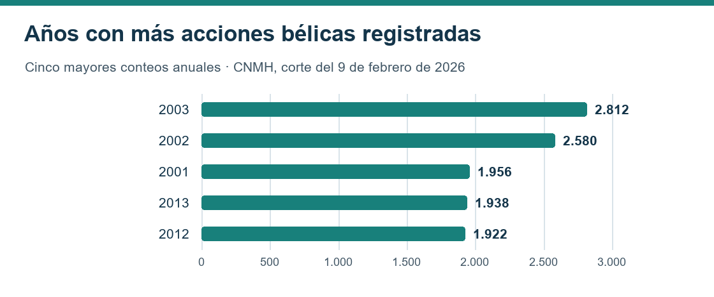

# Acciones bélicas en Colombia

Proyecto de **Análisis y Visualización de Datos** de la Universidad Nacional de Colombia. Explora cómo se distribuyeron las acciones bélicas registradas por el Observatorio de Memoria y Conflicto, y qué limitaciones tienen esos registros al analizar patrones históricos.

## Cuadernos

- [Entrega final](entregas/acciones_belicas_final.ipynb) · depuración de registros, análisis territorial, regresión logística, pruebas no paramétricas y mapas.
- [Resumen reproducible](analisis.ipynb) · tablas y gráficos que se pueden ejecutar con los datos agregados incluidos.

## Hallazgos del corte estudiado

- El archivo descargado el **9 de febrero de 2026** contenía **38.333 registros**. De ellos, 37.212 tenían una fecha completa válida y 220 carecían de un año utilizable.
- **2003** tuvo el mayor número de registros, con **2.812 acciones**. **Antioquia** fue el departamento con más registros, con **6.743**.
- La serie llega hasta julio de 2024, así que ese año tiene cobertura parcial. Los conteos describen eventos registrados y no estiman tasas poblacionales ni el efecto causal de cambios de política.



## Método y reproducción

El trabajo de clase examinó faltantes y duplicados, normalizó fechas y comparó patrones temporales y geográficos. Esta edición usa solo conteos agregados recuperados de los resultados del notebook original. El [cuaderno](analisis.ipynb) muestra las tablas y verifica los totales de calidad. Los [datos agregados](datos/) están incluidos.

Con una copia del CSV oficial se pueden volver a producir los agregados de años y departamentos. Consulta los nombres de campos y opciones en el [script de agregación](preparar_datos.py).

```bash
python preparar_datos.py ruta/al/archivo.csv --salida agregado_local
```

[Fuente original · Observatorio de Memoria y Conflicto, CNMH](https://micrositios.centrodememoriahistorica.gov.co/observatorio/portal-de-datos/el-conflicto-en-cifras/acciones-belicas/)

**Equipo académico** Manuela Zapata Jiménez y David Cardona Duque.

**English summary.** An exploratory analysis of 38,333 records of armed-conflict events in Colombia, with documented date completeness and aggregate comparisons across years and departments.
